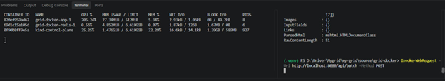
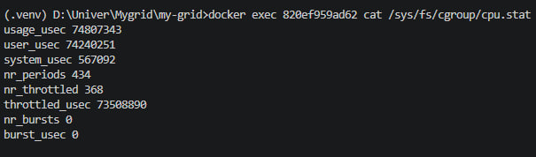
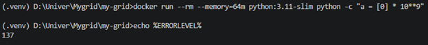
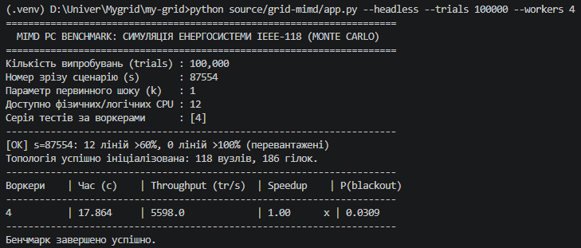
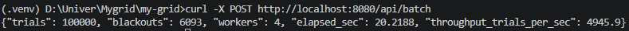

# Звіт: Docker та продуктивність симулятора IEEE-118

Дата перевірки: **15.10.2026**.

## Середовище

- Docker Engine: `29.2.1`.
- Образ застосунку: `python:3.11-slim`.
- Ліміт сервісу `app` у `docker-compose.yml`: **2 CPU** та **512 MiB RAM**.
- Пакетний тест: **100 000 trials**, `k=1`, **4 workers**.
- У наявному bare-metal бенчмарку: **12 логічних CPU**, сценарій `87554`.

Файли Docker-проєкту розташовані в `source/grid-docker/`. Для запуску з кореня репозиторію:

```powershell
cd source/grid-docker
docker compose up --build
```

## Перевірка REST API

| Запит | Результат |
|---|---|
| `GET /api/health` | `HTTP 200`, сервіс відповідає |
| `POST /api/step` | маршрут реалізований |
| `POST /api/batch` | перевірений, виконав 100 000 trials |


## 1. CPU Throttling

**Метод:** `POST /api/batch` з `multiprocessing.Pool` (4 процеси), 100 000 trials.

**Результат `docker stats`:**
```
CONTAINER ID   NAME                  CPU %     MEM USAGE / LIMIT     MEM %     NET I/O           BLOCK I/O   PIDS
820ef959ad62   grid-docker-app-1     205.24%   27.24MiB / 512MiB     5.34%     2.93kB / 1.06kB   0B / 49.2kB  8
6b51c15510ad   grid-docker-redis-1   0.50%     4.85MiB / 6.61GiB     0.07%     1.87kB / 120B     1.07MB / 0B  6
0f90b8ff9e5a   kind-control-plane    25.25%    1.47GiB / 6.61GiB     22.22%    16.6kB / 14.1kB   1.39GB / 58MB  927
```


Docker показує використання CPU у відсотках від одного ядра: `200%` відповідає ліміту двох CPU. Короткий пік понад `200%` у вибірці `docker stats` можливий через інтервал семплювання; квоту та тротлінг додатково перевірено через cgroup.

**Підтвердження тротлінгу через cgroup:**
```bash
docker exec 820ef959ad62 cat /sys/fs/cgroup/cpu.stat
```

## 2. Перевірка OOMKilled та коду 137

Контейнер з лімітом пам'яті `64 MiB` завершився через OOM під час контрольного виділення пам'яті. Після перевірки тестовий контейнер було видалено.

```text
docker run exit code: 137
OOMKilled=true ExitCode=137
```

Команда для повторення тесту та перевірки стану контейнера:

```powershell
docker run --rm --memory=64m python:3.11-slim python -c "a = [0] * 10**9"
```

`137 = 128 + 9`: процес завершено сигналом `SIGKILL` (сигнал 9), що узгоджується зі станом `OOMKilled=true`.

## 3. Порівняння часу виконання

| Варіант | Робоче навантаження | Час, с | Джерело |
|---|---|---:|---|
| Bare-metal | 100 000 trials, `k=1`, 4 workers | 17.8636 | `benchmark_results_mimd_grid.json`, CLI-бенчмарк, сценарій `87554` |
| Docker | 100 000 trials, `k=1`, 4 workers | 20.2920 | `POST /api/batch`, `elapsed_sec` |

Bare metal

Docker

За цими вимірами Docker-прогін довший на **2.4284 с**, або приблизно **13.6%** відносно bare-metal часу.

**Оверхед контейнеризації:**
- Час: **(20.219 / 17.864 − 1) × 100% = +13.2%**
- Throughput: **(1 − 4945.9 / 5598.0) × 100% = −11.7%**

**P(blackout) однаковий:** 0.0309 — симуляція коректна.

## Висновки

1. **CPU Throttling:** Docker успішно обмежує CPU до 2 ядер (`cpus: 2.0`). Підтверджено `nr_throttled = 368`.
2. **OOMKilled:** cgroups v2 вбиває процес при перевищенні `--memory=64m` (Exit Code 137).
3. **Оверхед контейнеризації:** ~12-13% через CPU throttling, cgroups і overlay filesystem. Для продакшн-систем це прийнятний компроміс за ізоляцію та відтворюваність.